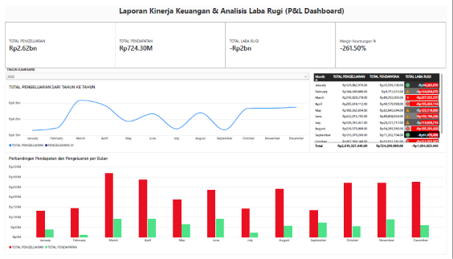
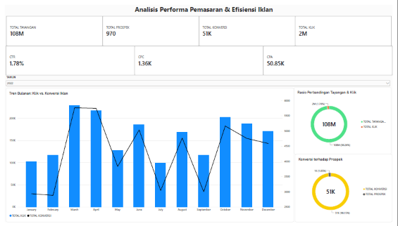

# 📊 Kreanara: Dashboard Kinerja Keuangan & Efisiensi Iklan (Power BI)

> Dashboard interaktif 2 halaman yang menjawab satu pertanyaan bisnis: **"Iklan kita ramai dan murah, tapi kenapa bisnisnya tetap rugi?"**


---

## 🎯 Latar Belakang & Tujuan

Manajemen perlu tahu apakah anggaran pemasaran dan operasional benar-benar menghasilkan keuntungan. Dashboard ini menggabungkan **data keuangan (P&L)** dan **data performa iklan digital** dalam satu alur cerita, sehingga keputusan tidak hanya didasarkan pada angka klik atau tayangan, tetapi juga pada **profitabilitas**.

**Pertanyaan yang dijawab:**
1. Apakah bisnis untung atau rugi, dan di bulan apa kerugian terdalam?
2. Apakah pengeluaran iklan menghasilkan pendapatan yang sebanding?
3. Seberapa efisien kampanye iklan (CTR, CPC, CPA)?
4. Di mana akar masalah sebenarnya?

---

## 🖼️ Tampilan Dashboard

### Halaman 1: Laporan Kinerja Keuangan & Laba Rugi


### Halaman 2: Analisis Performa Pemasaran & Efisiensi Iklan


> **Interaktif:** gunakan *slicer* **Tahun** (2022, 2023, 2024) di tiap halaman. Seluruh angka di bawah memakai data **tahun 2022** sebagai contoh analisis.

---

## 🔢 Angka Kunci (Tahun 2022)

| Metrik | Nilai |
|---|---|
| Total Pengeluaran | Rp2,62 Miliar |
| Total Pendapatan | Rp724,30 Juta |
| **Laba/Rugi Bersih** | **-Rp1,89 Miliar** |
| Margin Keuntungan | -261,50% |
| Tayangan (Impressions) | 108 Juta |
| Klik | 2 Juta |
| Konversi | 51 Ribu |
| CTR | 1,78% |
| CPC | Rp1.360 |
| CPA | Rp50.850 |

---

## 💡 Temuan Utama

### 1. Bisnis rugi sepanjang tahun, tanpa satu pun bulan yang untung
Seluruh bulan Januari–Desember berstatus **laba rugi negatif**. Kerugian terdalam terjadi pada **Maret (-Rp227,5 Juta)** dan **Desember (-Rp215,3 Juta)**.

### 2. Belanja iklan naik, pendapatan tidak ikut naik
Pengeluaran memuncak pada **Maret (Rp316,8 Juta)** dan **April (Rp285,6 Juta)**, tetapi pendapatan Maret hanya **Rp89,3 Juta**. Menambah anggaran tidak otomatis menambah pendapatan secara sebanding.

### 3. Iklannya "sehat", tetapi ekonominya tidak
- **CTR 1,78%** menunjukkan materi iklan cukup menarik perhatian.
- Tren klik dan konversi bergerak searah (puncak di Maret, April, Oktober), jadi penargetan berjalan baik.
- **Namun:** biaya untuk mendapatkan 1 konversi (**CPA ± Rp50.850**) jauh lebih besar daripada pendapatan rata-rata per konversi (**± Rp14.200**, yaitu Rp724,30 Juta ÷ 51 Ribu konversi).

> ⚠️ **Inti masalahnya:** setiap konversi rata-rata *merugi sekitar Rp36.000*. Selama CPA lebih tinggi dari nilai transaksi, makin banyak iklan = makin besar kerugian, seefisien apa pun angka CTR dan CPC-nya.

---

## ✅ Rekomendasi

| # | Rekomendasi | Alasan |
|---|---|---|
| 1 | **Naikkan nilai transaksi** (penyesuaian harga, bundling, *upsell*, minimum order) | Pendapatan per konversi harus melampaui CPA agar tiap konversi menguntungkan |
| 2 | **Turunkan CPA** lewat penyempitan target audiens dan evaluasi kampanye di bulan boros (Maret–April) | Anggaran puncak tidak menghasilkan pendapatan puncak |
| 3 | **Tetapkan batas CPA** berdasarkan margin per produk sebelum menambah anggaran | Mencegah ekspansi iklan yang justru memperbesar kerugian |
| 4 | **Bandingkan YoY 2022 → 2024** dengan slicer tahun | Mengukur apakah perbaikan strategi benar-benar menekan defisit |

---

## 🛠️ Cara Membuka

1. Unduh file `data_kreanara.pbix` dari repositori ini.
2. Buka dengan **Power BI Desktop** (gratis).
3. Gunakan slicer **Tahun** untuk berpindah periode.

## 📁 Struktur Repositori

```
├── data_kreanara.pbix
├── images/
│   ├── halaman-1-pnl.png
│   └── halaman-2-marketing.png
└── README.md
```

## 🧰 Skill yang Diterapkan

`Power BI` · `Data Visualization` · `Dashboard Design` · `KPI & Business Metrics` · `Financial Analysis (P&L)` · `Marketing Analytics` · `Data Storytelling`

---

## 👤 Tentang Saya

**MUHAMMAD AS'AD DIFINUBUN**: lulusan Teknik Informatika, berfokus pada Data Analyst / Data Scientist.
📫 Hubungi saya: *(https://www.linkedin.com/in/muhammad-as-ad-difinubun-9b9476422/?isSelfProfile=true)] /([aicoding382@gmail.com])*
